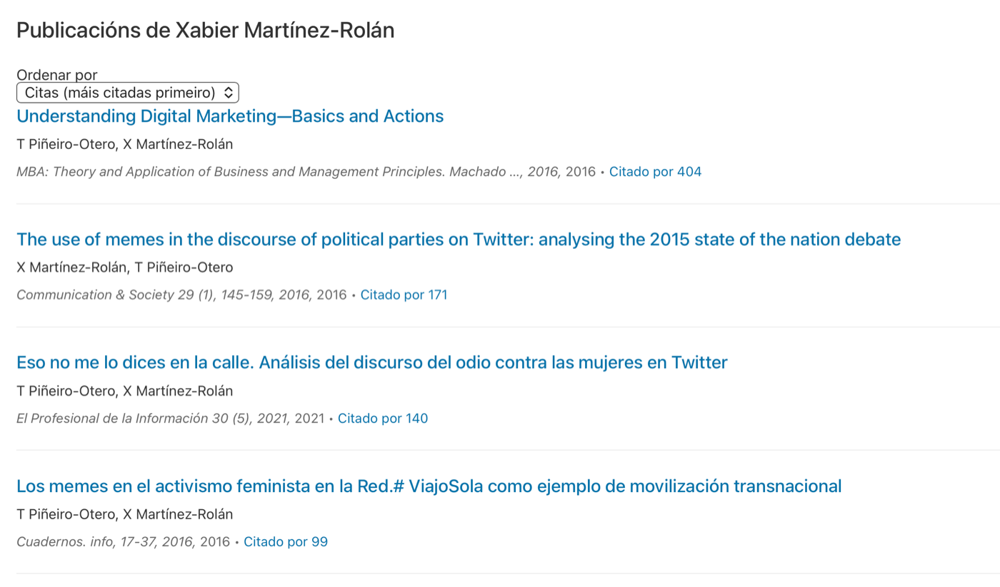

# WP Scholar Integration

Muestra tus publicaciones de Google Scholar en WordPress con un shortcode. / Shows your Google Scholar publications in WordPress via shortcode.

- Selector de orden en la web: año (más reciente / más antiguo) o número de citas.
- Hasta 500 publicaciones por perfil (paginación automática).
- Caché configurable, caché de fallos y copia de la última respuesta buena si Google bloquea.
- Traducciones incluidas: gallego y castellano (según el idioma del sitio).



## Instalación

Descarga `wp-scholar-integration.zip` desde [Releases](https://github.com/xabimr/wp-scholar-integration/releases/latest) y súbelo en **Plugins → Añadir nuevo → Subir plugin** (o descomprímelo en `wp-content/plugins/`). El zip de "Source code" que genera GitHub no sirve para instalar directamente, porque la carpeta se llama distinto. Después actívalo y configura tu ID en **Ajustes → Google Scholar** (acepta la URL del perfil).

## Uso

```
[google_scholar]
[google_scholar id="ABC123XYZ" limit="20" sort="cited_desc" show_sort="no"]
```

| Atributo | Valores | Por defecto |
|---|---|---|
| `id` | ID o URL del perfil | el de Ajustes |
| `limit` | número (`0` = todas) | `10` |
| `year` | año concreto | — |
| `sort` | `year_desc`, `year_asc`, `cited_desc` | `year_desc` |
| `show_sort` | `yes` / `no` | `yes` |
| `show_author` | encabezado "Publicaciones de…" | `yes` |
| `show_authors` | autores de cada publicación | `yes` |
| `show_venue`, `show_year`, `show_citations` | `yes` / `no` | `yes` |
| `title_tag` | `h1`–`h6`, `div`, `p`, `span` | `h3` |

## Aviso

Google Scholar no ofrece API oficial: el plugin lee el HTML público del perfil, lo que puede incumplir sus condiciones de uso y puede ser bloqueado por Google. Úsalo bajo tu responsabilidad y con caché razonable.

## Publicar una versión

Sube la versión en `wp-scholar-integration.php` (cabecera y constante) y en `CHANGELOG.md`, haz commit y crea el tag: `git tag v1.5.5 && git push origin main v1.5.5`. La GitHub Action construye el zip y crea la release sola.

## Licencia

MIT. Ver [LICENSE](LICENSE).
